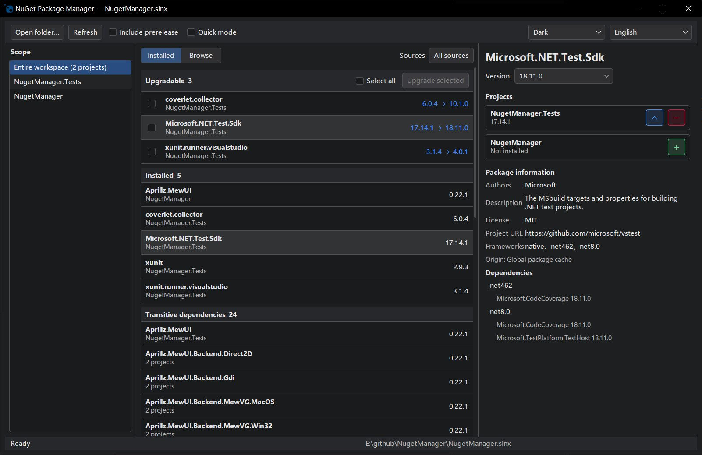

# NuGet Package Manager

A Windows desktop NuGet package manager built with .NET 10, Native AOT, and [Aprillz.MewUI](https://www.nuget.org/packages/Aprillz.MewUI).

Why build this tool?

I like Rider's built-in package manager, but I no longer use Rider very often, so I wanted a standalone tool for managing NuGet packages.

> **Note:** This tool was generated by AI. Use it with care.



## Features

- Inspect dependencies by solution or project; browse, search, install, uninstall, upgrade, and downgrade NuGet packages. Prerelease versions and batch upgrades are supported.
- Supports Central Package Management (CPM) via `Directory.Packages.props`. Review affected projects and files before changes; unsafe edits, such as conditional references, are explicitly blocked.
- Optional **Quick Mode** executes a valid plan without confirmation. Safety blocks, failure notifications, and transaction rollback still apply.
- Failed or cancelled writes attempt to roll back the current batch. If the app exits unexpectedly, recovery is offered on the next launch; detected file conflicts are never overwritten.
- Supports multiple package sources, light and dark themes, and multiple UI languages.

## Requirements

- Windows x64 and the .NET 10 SDK. The app uses the SDK for package queries, installation, removal, and restore, so the SDK is still required when running the Native AOT build.
- The SDK selected by `global.json` must support `dotnet package list --format json`. The app will not silently switch SDK versions.
- Managed projects can target any framework the installed SDK can restore; they do not have to target .NET 10.

## Usage

- Launch the app and choose a directory.
- To open the current working directory from a console:

    ```powershell
    nugetmgr.exe
    ```

- To start the app with a specific workspace directory:

    ```powershell
    nugetmgr.exe [workspace-directory]
    ```

Without an argument, the app uses the current working directory. Relative paths are also resolved from the current working directory. You can also launch the app and choose a workspace with **Open Directory...**.

If the root directory contains `.sln` or `.slnx` files, the selected solution determines which C# projects are managed. If there are multiple solutions, you choose one. Without a solution, the app recursively discovers `.csproj` files and skips `bin`, `obj`, and `.git` directories.

## Important behavior

- Projects are restored when loaded to obtain current dependency state. Existing `packages.lock.json` files use locked mode; read-only loading does not create or modify lock files. A successful restore does not mean the project has compiled.
- By default, every write previews its impact and requires confirmation; Quick Mode skips confirmation. Central version changes may affect multiple projects. With CPM, uninstalling a package removes only the project reference; its `PackageVersion` is not automatically deleted.
- Search and package operations use the workspace's `NuGet.Config` and SDK credentials. This app does not manage credentials; configure authentication for private sources in the SDK environment first.

## Build, test, and publish

```powershell
dotnet build NugetManager.slnx
dotnet test NugetManager.Tests\NugetManager.Tests.csproj
dotnet publish NugetManager\NugetManager.csproj -c Release -r win-x64 -p:PublishAot=true
```

Native AOT publishing requires Visual Studio's **Desktop development with C++** workload.
