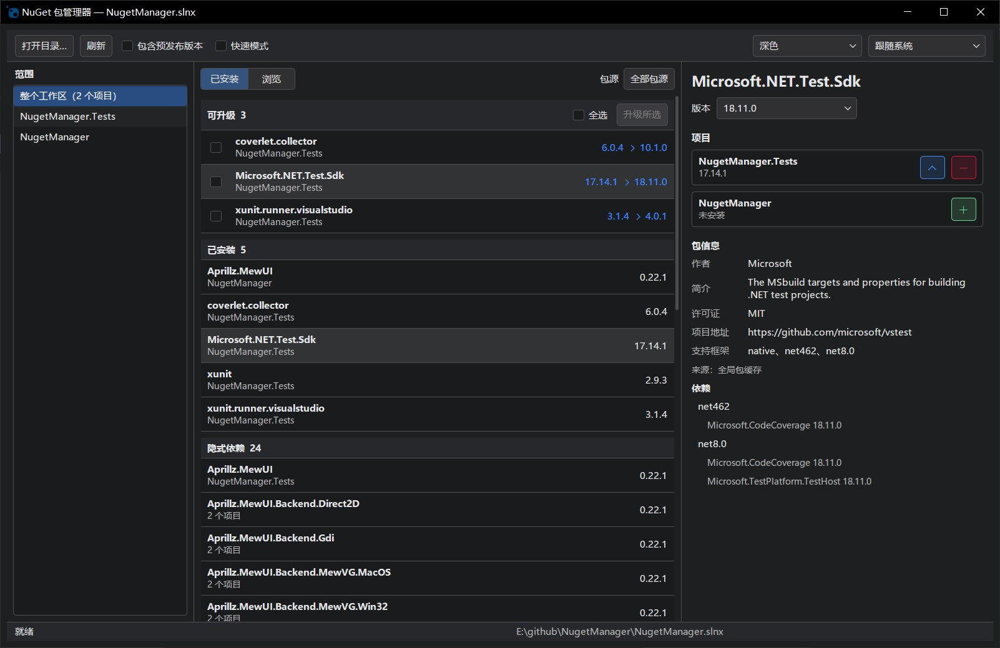

# NuGet 包管理器

基于 .NET 10、Native AOT 和 [Aprillz.MewUI](https://www.nuget.org/packages/Aprillz.MewUI) 的 Windows 桌面 NuGet 包管理工具。

为什么要制作这个工具？

我喜欢使用 Rider 内置软件包管理，但我已经不怎么使用 Rider，所以想要一个独立的工具来管理 NuGet 包。

> **注意**：本工具由 AI 生成，请谨慎使用。



## 功能

- 按解决方案或项目查看依赖，浏览、搜索、安装、卸载、升级和降级 NuGet 包；支持预发布版本和批量升级。
- 支持 `Directory.Packages.props` 集中版本管理（CPM），操作前预览受影响项目与文件；无法安全修改的条件引用等会明确阻止。
- 可选“快速模式”会在生成有效计划后跳过确认并立即执行；安全阻止、失败提示和事务回滚仍然生效。
- 写操作失败或取消时会尝试撤回本批修改；程序异常退出后可在下次启动时恢复，且不会覆盖检测到的冲突文件。
- 支持多个包源、浅色/深色主题和多种界面语言。

## 环境要求

- Windows x64 和 .NET 10 SDK。程序通过 SDK 执行包查询、安装、卸载和还原，因此即使使用 Native AOT 发布版本，运行时仍需安装 SDK。
- `global.json` 指定的 SDK 必须支持 `dotnet package list --format json`；程序不会静默切换 SDK。
- 被管理项目可使用 SDK 能够还原的目标框架，不必是 .NET 10。

## 使用

- 手动打开程序选择目录

- 从控制台打开当前工作目录

```powershell
nugetmgr.exe
```

- 指定工作目录启动程序

```powershell
nugetmgr.exe [工作目录]
```

不带参数时使用当前工作目录；指定的相对路径也以当前工作目录为基准。也可以双击启动后通过“打开目录...”选择工作目录。

根目录有 `.sln` 或 `.slnx` 时，按所选解决方案管理其中的 C# 项目；有多个解决方案时由用户选择。没有解决方案时递归查找 `.csproj`，并跳过 `bin`、`obj` 和 `.git` 目录。

## 重要行为

- 加载项目会先执行还原以获取最新依赖状态。已有 `packages.lock.json` 时使用锁定模式；只读加载不会新建或改写锁文件。还原成功不代表项目已编译通过。
- 默认每次写操作都会预览影响并要求确认；启用快速模式后会跳过确认。集中版本变更可能影响多个项目；CPM 卸载只移除项目引用，不会自动删除 `PackageVersion`。
- 搜索与操作沿用工作区的 `NuGet.Config` 和 SDK 凭据配置。本工具不管理凭据；需要认证的私有源请先在 SDK 环境中完成设置。

## 构建、测试与发布

```powershell
dotnet build NugetManager.slnx
dotnet test NugetManager.Tests\NugetManager.Tests.csproj
dotnet publish NugetManager\NugetManager.csproj -c Release -r win-x64 -p:PublishAot=true
```

Native AOT 发布需要安装 Visual Studio“使用 C++ 的桌面开发”工作负载。
